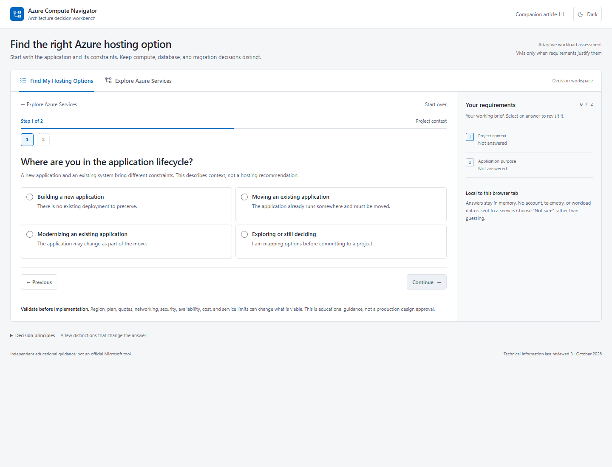
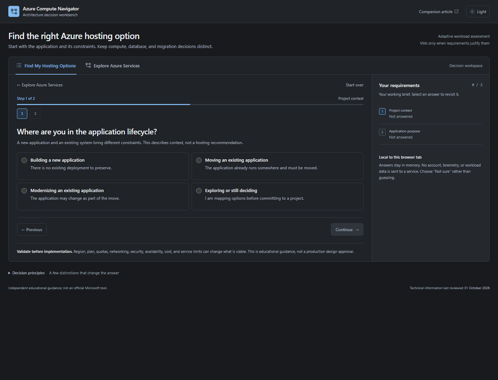

# Azure Compute Navigator

**An independent, interactive guide to choosing the right Azure hosting service.**

Created by **Precious Ajuru**. The [public source repository](https://github.com/preciousajuru/azure-compute-navigator) and [live GitHub Pages application](https://preciousajuru.github.io/azure-compute-navigator/) are available.

Azure Compute Navigator helps engineers compare Azure App Service, Azure Container Apps, AKS Automatic, AKS Standard, Azure Functions, and Azure Static Web Apps against an application's real requirements. Azure Virtual Machines appear as a conditional option when guest-OS control is a verified requirement.

It brings together a connected architecture map, a contextual service brief, a guided workload assessment, and a companion technical article. The interface is an engineering workbench, with neutral light and dark themes. The project is educational guidance, not an official Microsoft tool or production design approval.

## Why it exists

Several Azure services can host containers, APIs, and background work. A useful choice depends on workload shape, Kubernetes API requirements, scaling, networking, operational responsibility, and whether a model is called or hosted. The navigator makes those trade-offs visible instead of mapping keywords such as “AI,” “Docker,” or “GPU” to one answer.

## Use the guide

Build and preview the site using the commands below. **Find My Hosting Options** is the default. The adaptive assessment starts with project lifecycle and application purpose, then asks only relevant questions about runtime, existing deployment, database, execution, Kubernetes, and special requirements. Compute recommendations and database migration considerations are reported separately.

In **Explore Azure Services**, select a requirement to highlight connected managed compute services, then select a service to inspect its capabilities, responsibilities, constraints, and sources. The comparison table gives a compact overview of the operating models. **Assess this service** pre-fills a workload for review, rather than treating a selection as a recommendation.

The assessment:

- Shows a primary starting point only when the selected requirements support one.
- Returns a shortlist or asks for more information when the fit depends on unresolved details.
- Explains the reasons, trade-offs, remaining responsibilities, and official sources.
- Keeps categorical answers in the browser and only copies them when you ask to copy a summary.
- Does not collect credentials, tenant IDs, customer data, or free-text workload details.

The theme switch saves only a light/dark preference in local storage. Assessment answers remain in memory. At narrow widths, the service brief moves below the map; selecting a service moves focus to the brief, and **Back to map** returns to the selected node.

The result is a starting point. Validate the target region, service plan, quotas, networking, security, availability, pricing, and operational model before implementation.

## Screenshots

These are actual browser captures, not mock-ups. Both themes were reviewed at 375, 768, 1024, and 1440 CSS pixels.





| Viewport | Light theme | Dark theme |
|---|---|---|
| 375 px | [Mobile](assets/screenshots/azure-compute-navigator-light-375.png) | [Mobile](assets/screenshots/azure-compute-navigator-dark-375.png) |
| 768 px | [Tablet](assets/screenshots/azure-compute-navigator-light-768.png) | [Tablet](assets/screenshots/azure-compute-navigator-dark-768.png) |
| 1024 px | [Narrow desktop](assets/screenshots/azure-compute-navigator-light-1024.png) | [Narrow desktop](assets/screenshots/azure-compute-navigator-dark-1024.png) |
| 1440 px | [Desktop](assets/screenshots/azure-compute-navigator-light-1440.png) | [Desktop](assets/screenshots/azure-compute-navigator-dark-1440.png) |

Assessment examples: [desktop result and requirements](assets/screenshots/azure-compute-navigator-assessment.png), [mobile result in dark mode](assets/screenshots/azure-compute-navigator-assessment-mobile-dark.png).

## Services covered

The main explorer compares App Service, Container Apps, AKS Automatic, AKS Standard, Azure Functions, and Azure Static Web Apps. Azure Virtual Machines appear in assessment results only when OS-level or server-level control is a verified requirement or migration dependency.

## How recommendations work

The rules are deterministic and readable in [`src/logic/recommendations.js`](src/logic/recommendations.js). Service descriptions are kept separately in [`src/data/services.js`](src/data/services.js). The model distinguishes explicit Kubernetes constraints, workload/deployment shape, GPU requirements, scaling preferences, and unresolved questions. There is no numerical confidence score.

The rule rationale and limitations are documented in [`docs/decision-rules.md`](docs/decision-rules.md). Source verification is recorded in [`docs/references.md`](docs/references.md).

## Run locally

Requires **Node.js 24 or newer** and npm. The only package dependency is a pinned, build-time Markdown renderer. The browser application and rendered article have no third-party runtime dependencies, CDNs, analytics or paid infrastructure requirements.

```powershell
npm ci --ignore-scripts
npm test
npm run check
npm run build
npm run preview
```

Open `http://127.0.0.1:8001/azure-compute-navigator/`. The preview binds only to localhost and serves the **built `_site` directory**, including the article at `http://127.0.0.1:8001/azure-compute-navigator/article/choosing-azure-compute.html`. It deliberately uses a project subpath to catch GitHub Pages path mistakes.

Re-run `npm run build` after edits, then refresh. Stop the preview with Ctrl+C. A local preview is not a public deployment.

## Companion article

Read the sole, authoritative article in [`article/choosing-azure-compute.md`](article/choosing-azure-compute.md), or [open its published HTML](https://preciousajuru.github.io/azure-compute-navigator/article/choosing-azure-compute.html). It is an 8–10 minute guide to App Service, Container Apps, AKS Automatic and Standard, Functions, Static Web Apps and VMs, with four practical scenarios, a WordPress/MariaDB migration example, one comparison table and a genuine application screenshot.

The Markdown is also the portable Medium/personal-website copy: it contains absolute application and screenshot links, and needs no project-specific rendering to read. The static build maps those canonical URLs to local application and asset paths, so the website renders the same article source. It adds semantic HTML, contents navigation, stable heading anchors, a scrollable comparison table, light/dark themes and a full-size image link. Build validation checks every service's article target, including Virtual Machines.

The article and publication setup are awaiting the author's final editorial approval. Relative application/article links work locally and will work under the Pages project path. Absolute public URLs will only be recorded after a verified deployment.

## Project layout

```text
index.html
package.json
package-lock.json
LICENSE
CONTENT-LICENSE.md
README.md
src/
  app.js, theme.js, styles.css
  data/config.js, questions.js, services.js
  logic/recommendations.js
scripts/
  build.mjs, serve.mjs
tests/
  assessment.test.js, recommendations.test.js
  site.test.js, theme.test.js, publication.test.js
article/
  choosing-azure-compute.md, template.html, article.css
assets/
  diagrams/
  screenshots/
docs/
  architecture.md, decision-rules.md, references.md
  contributing.md, manual-testing.md, community-impact.md
drafts/
  linkedin-announcement.md
.github/
  ISSUE_TEMPLATE/correction.yml
  workflows/ci.yml, pages.yml
.gitignore
.gitattributes
```

`_site/` and `node_modules/` are generated and ignored. They are not initial-commit content.

See [`docs/architecture.md`](docs/architecture.md) for the application boundaries and [`docs/manual-testing.md`](docs/manual-testing.md) for browser checks.

## Contributing and corrections

Contributions that improve technical accuracy, accessibility, and clarity are welcome. Read [`docs/contributing.md`](docs/contributing.md). Use the **Architectural guidance correction** issue template to report a claim that is outdated, incomplete, or too broad. Include the affected service or rule, a Microsoft source, and the relevant region/plan/context if applicable.

## Scope and limitations

This project does not:

- Produce a complete architecture, security review, compliance decision, or deployment design.
- Promise cost, performance, availability, region, or quota outcomes.
- Treat a keyword as a hard platform requirement.
- Replace validation against current Microsoft documentation and the Azure Pricing Calculator.
- Provide Microsoft endorsement or a guarantee of suitability.

## Licensing

Copyright (c) 2026 Precious Ajuru. Application code, scripts, tests, configuration and presentation templates are under the [MIT License](LICENSE). Original article/README/documentation prose, diagrams and application screenshots are under [Creative Commons Attribution 4.0 International](CONTENT-LICENSE.md).

Generated HTML preserves that boundary: MIT presentation code surrounding CC BY 4.0 content. Third-party dependencies retain their own licences. Neither licence grants rights to Microsoft names, trademarks or third-party documentation. Generic original diagrams/icons do not imply Microsoft affiliation or endorsement.

## GitHub Pages deployment

The [public repository](https://github.com/preciousajuru/azure-compute-navigator) is owned by the verified GitHub account `preciousajuru`. The [live application](https://preciousajuru.github.io/azure-compute-navigator/) and [published companion article](https://preciousajuru.github.io/azure-compute-navigator/article/choosing-azure-compute.html) are served from GitHub Pages.

The deployment uses a **Node static build**, not Jekyll. CI runs a clean dependency installation, syntax checks, automated tests and the same build used locally. The build copies only public assets, renders the article, source register and content licence, and validates local links and service anchors. Documentation drafts, tests and dependencies are not uploaded.

Pages uses **GitHub Actions**. The **Deploy static site to GitHub Pages** workflow is intentionally manual-only (`workflow_dispatch`): a push does not publish. It uploads `_site` as the Pages artifact, then deploys in a separate `github-pages` environment job using GitHub's built-in token/OIDC permissions. No personal token or Azure credential is required.

The deployment workflow, public homepage, article, screenshot and production browser flows have been verified. See [`docs/publishing-checklist.md`](docs/publishing-checklist.md) for the portable article and external-image details.

## Project links

- Public source repository: https://github.com/preciousajuru/azure-compute-navigator
- Published application: https://preciousajuru.github.io/azure-compute-navigator/
- Published article: https://preciousajuru.github.io/azure-compute-navigator/article/choosing-azure-compute.html
